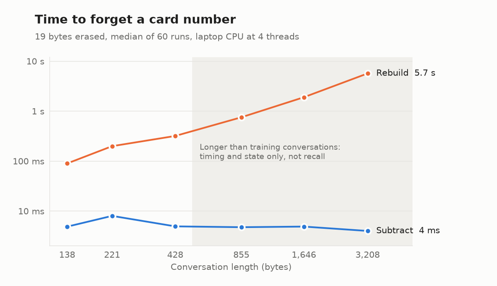
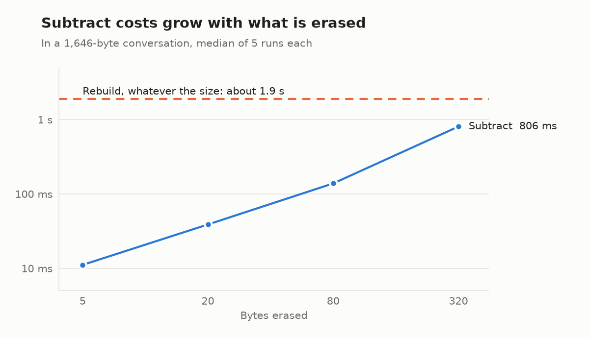

# DragonScope

[](https://github.com/theoreticalraccoon/dragonscope/actions/workflows/tests.yml)

A debugger for the memory of BDH (Dragon Hatchling) models. It records what a model's memory holds while it reads, shows it live, erases chosen text from it, and measures whether the erasure worked.

BDH keeps a session's context in one fixed-size state, `rho`, which the paper treats as a compressed form of the synaptic state. DragonScope makes that state something you can inspect and edit:

- **Capture:** wrap a model and record each byte's effect on memory, with neuron firing per round.
- **Memory map:** a live dashboard of the real neurons firing, the text in memory, and which neurons change because of text you choose to watch.
- **Forget:** remove every copy of a value from memory, by targeted subtraction or by rereading the session without it.
- **Forgetting report:** test your own probes before forgetting, after `subtract` and after `rebuild`, and record the residual and cost.

The flagship example is a bank assistant that remembers a card number and then forgets it, built for FITIS INFOTEL 2026.

All conversation data is synthetic. Never type real card or ID numbers into it.

## Quick start

```bash
git clone https://github.com/theoreticalraccoon/dragonscope
cd dragonscope
pip install -e ".[dashboard]"
```

```python
import dragonscope as ds

model = ds.load_model("models/best_model.pt")   # or any BDH model from pathwaycom/bdh
memory = ds.capture(model)
memory.read("U: My card number is 4242 4242 4242 4242.\nA: Noted.\n")

edit = memory.forget("4242 4242 4242 4242")      # subtract, as every byte has a ledger entry
print(edit.method, edit.copies, edit.bytes_erased, edit.seconds, edit.residual)

memory.forget("Noted.", method="rebuild")        # exact, but rereads the session
ds.dashboard(memory)                             # http://127.0.0.1:8100
```

Or open the dashboard from a terminal: `dragonscope-dashboard --model models/best_model.pt`, or `--untrained` to try it with random weights.

[notebooks/getting_started.ipynb](notebooks/getting_started.ipynb) walks through capture, forgetting and a report in about a minute on a laptop CPU, with its outputs saved.

## API

| Call | What it does |
|---|---|
| `ds.capture(model, keep_states=False, ledger="exact")` | Wraps a BDH model. Returns a `MemoryCapture`. `ledger` is `"exact"`, `"compact"` or `"off"`, as below. `keep_states` copies `rho` at every byte, which is only practical for small models. |
| `memory.read(text, ledger=None)` | Reads text, recording a `Step` per byte in `memory.history`. `ledger=False` keeps no ledger entries for this text. |
| `memory.generate(max_bytes, stop="\n")` | Writes greedily. What it writes enters memory. |
| `memory.find(text)` | The positions of every copy of the text in memory. |
| `memory.forget(target, method="auto")` | `target` is text, bytes or a `(start, end)` range. `auto` uses `subtract` when every byte has a ledger entry, and `rebuild` otherwise. Returns a `ForgetResult` with the method used, copies, bytes erased, time and residual per round. Forgotten bytes leave the history too. |
| `memory.rebuild()`, `memory.residual(stepped=False)` | Rereads the surviving text into a fresh memory, and measures the distance from doing so. `stepped=True` rereads byte by byte, which is about 10 times slower but checks `rebuild` independently. |
| `memory.ledger_bytes` | Memory held by the ledger that `subtract` uses. |
| `memory.fork()`, `memory.reset()` | An independent copy, and an empty session. |
| `memory.neuron_strength()` | How much memory each neuron holds, per head. |
| `ds.forgetting_report(model, cases)` | Runs `ds.Case(text, forget, probes)` cases with `ds.Probe(prompt, expect, about)`. Returns a `ForgettingReport` with `passed`, `to_markdown()`, `to_dict()` and `save()`. |
| `ds.dashboard(memory, port=8100)` | Opens the dashboard for a session in the background. |

A report needs at least one probe about a forgotten value, and fails if its probes could not recall the value before forgetting, so a model that never learned the value cannot earn a pass.

## Forget versus rebuild

Rereading the session without the value is perfect forgetting by definition. So the targeted edit has to answer two questions: how close does it get, and how much cheaper is it? Results are from `python -m dragonscope.benchmark`, 20 conversations per length, on the demo model on an i5-1335U laptop at 4 threads. Raw numbers are in [docs/benchmark/results.json](docs/benchmark/results.json).

<picture>
  <source media="(prefers-color-scheme: dark)" srcset="docs/benchmark/time_by_length_dark.png">
  
</picture>

| Conversation | `subtract` | `rebuild` | Residual after `subtract` | Recall before, after | Kept | Ledger |
|---|---|---|---|---|---|---|
| 138 bytes | 4.9 ms | 90 ms | 5.2% | 100%, 0% | 100% | 7 MB |
| 221 bytes | 8.0 ms | 199 ms | 4.4% | 100%, 0% | 100% | 16 MB |
| 428 bytes | 4.9 ms | 318 ms | 4.3% | 60%, 0% | 85% | 27 MB |
| 855 bytes | 4.7 ms | 752 ms | 5.7% | not measurable | | 56 MB |
| 1,646 bytes | 4.9 ms | 1.9 s | 5.3% | not measurable | | 110 MB |
| 3,208 bytes | 4.0 ms | 5.7 s | 4.0% | not measurable | | 221 MB |

What this shows:

- **Cost.** `subtract` stays at about 5 ms whatever the conversation length, while `rebuild` grows faster than linearly: 18 times slower at 138 bytes, and over 1,000 times at 3,208.
- **Accuracy.** Wherever the model could recall the card, `subtract` removed it as fully as `rebuild` did, kept the other value as well, and gave identical replies. Its residual is 4 to 6% of the state from the second round on, and 0 in the first. `rebuild` leaves a residual under 1e-6.
- **Limits.** The model was trained on conversations of up to 512 bytes and cannot recall anything beyond that, so longer rows measure cost and state only. There, `subtract` and `rebuild` gave the same reply in only 22 to 42% of probes, because the residual shifts an already unreliable model. The residual is not small for every model: on random weights it was about 46%.

<picture>
  <source media="(prefers-color-scheme: dark)" srcset="docs/benchmark/time_by_erased_size_dark.png">
  
</picture>

`subtract` scales with what is erased, not with the whole history: 4 ms for 5 bytes and 34 ms for 320.

**Use `subtract` for speed, then `rebuild` when you need no residual.** The bank demo does both. None of this is a security proof or machine unlearning: the weights never change, and the evidence covers these probes on this model.

## Memory at the published BDH size

`subtract` needs a ledger entry for every byte it may erase, and the ledger grows with the session. At the published BDH default size (6 layers, 32,768 neurons, 25.3M parameters), measured with `python -m dragonscope.benchmark --scale` on random weights, since no trained model of that size was available:

| Session | Read, per byte | `subtract`, 19 bytes | `rebuild` | Ledger, exact | Ledger, compact |
|---|---|---|---|---|---|
| 256 bytes | 180 ms | 71 ms | 2.4 s | 203 MB | 101 MB |
| 512 bytes | 178 ms | 161 ms | 5.1 s | 406 MB | 203 MB |
| 1,024 bytes | 173 ms | 239 ms | 11.7 s | 812 MB | 406 MB |

`rho` itself stays at 201 MB. Raw numbers are in [docs/benchmark/scale.json](docs/benchmark/scale.json).

So a full ledger is affordable for short sessions but not for long ones. Three settings keep it in check:

- `ds.capture(model, ledger="compact")` stores entries in float16, dropping zeros where that is smaller. It halves the ledger at this size and cuts it 2.7 times on the trained demo model, which fires fewer neurons. It adds a relative error of about 1e-4 to `subtract`.
- `memory.read(text, ledger=False)` records nothing for text that will never need forgetting, such as a system prompt or a document. Only recorded bytes cost memory: a 19-byte card number costs 15 MB at this size, however long the session.
- `ds.capture(model, ledger="off")` keeps no ledger, and `forget` uses `rebuild`.

## The bank demo

```bash
python -m dragonscope.server
```

Then open http://127.0.0.1:8000. A visitor gives a fake card number, asks for it back, forgets it, and asks again. The version frozen for FITIS INFOTEL 2026 is tag `infotel-2026-v1`, on branch `infotel-2026`, with tested package versions in `requirements-lock.txt`. The booth kit is in `booth/`.

On a 500-case evaluation, exact recall of the forgotten card or NIC went from 100% to 0% with both methods, and other fields stayed at 100%. See [docs/EVALUATION.md](docs/EVALUATION.md).

## Split-brain gateway (prototype)

```bash
python -m dragonscope.gateway
```

Then open http://127.0.0.1:8200. BDH holds a confidential case in its memory, and identifiers are replaced with random codes. A four-layer leak gate checks the outgoing text before an outside model sees it, and a named reviewer approves each draft once real values are restored. It runs offline by default; `--connector anthropic` sends the cleared text to Claude.

Measured on synthetic data written by the same author as the rules, no labelled identifier reached the outgoing text, and no clean request was blocked. That is not a real-world rate: one-word names and names in Sinhala or Tamil script would get through. The experimental memory check did not beat the rules. See [docs/GATEWAY.md](docs/GATEWAY.md) for what is built, what is a gap, and legal notes that are not legal advice.

## Train a model

```bash
python -m dragonscope.data --out data
python -m dragonscope.train --data data --out runs/main
```

Training resumes from `latest.pt` if you rerun the same command. On a CPU it is slow, so use [notebooks/train_gpu.ipynb](notebooks/train_gpu.ipynb) on Colab or Kaggle.

The demo model was trained on conversations of up to 512 bytes. For a model that recalls across longer sessions, add `--max-bytes 2048 --pad-to 2048` to the data command, which pads conversations with small talk between the statements and the questions. The notebook's `long` run does this. No long model has been trained yet.

## Tests

```bash
pip install -e ".[dashboard,dev]"
python -m pytest -q
```

They take about 6 minutes on a laptop CPU, and run on every push. The stateful engine is checked against the unmodified BDH forward pass, with logits within 1e-3. See [CONTRIBUTING.md](CONTRIBUTING.md) and [CHANGELOG.md](CHANGELOG.md).

## Layout

| Path | Purpose |
|---|---|
| `dragonscope/toolkit.py` | `capture` and `MemoryCapture` |
| `dragonscope/report.py` | Forgetting reports |
| `dragonscope/dashboard.py` | The toolkit dashboard, for any session |
| `dragonscope/benchmark.py` | Forget versus rebuild, and cost at the published size |
| `dragonscope/engine.py` | Stateful inference, the memory `rho`, the ledger and Forget |
| `dragonscope/activity.py` | Records which neurons really fire for each byte |
| `dragonscope/server.py`, `session.py`, `detect.py` | The bank demo |
| `dragonscope/gateway/` | The split-brain gateway prototype and its review console |
| `dragonscope/data.py`, `train.py`, `evaluate_forget.py` | Synthetic data, training and evaluation |
| `dragonscope/static/` | The pages and the 3D brain, with three.js bundled locally |
| `dragonscope/vendor/bdh/` | Unmodified upstream BDH, with its licence |
| `scripts/` | Booth checks, rehearsal and benchmark charts |
| `docs/` | Evaluation, benchmark results and the demo's message protocol |
| `docs/dev/` | Development status and the INFOTEL plan |

## Licence

DragonScope is under the MIT licence in [LICENSE](LICENSE).

`dragonscope/static/vendor/three.min.js` is three.js 0.160.0, under the licence in [three-LICENSE.txt](dragonscope/static/vendor/three-LICENSE.txt).

`dragonscope/vendor/bdh/` is from [pathwaycom/bdh](https://github.com/pathwaycom/bdh) at commit `2b0d7a45b058d4309c84a10e0768d541fe18bdc2`. It is copyright 2025 Pathway Technology, Inc., under the MIT licence in [its LICENSE.md](dragonscope/vendor/bdh/LICENSE.md).

The paper is Kosowski et al., "The Dragon Hatchling: The Missing Link between the Transformer and Models of the Brain", [arXiv:2509.26507](https://arxiv.org/abs/2509.26507).
